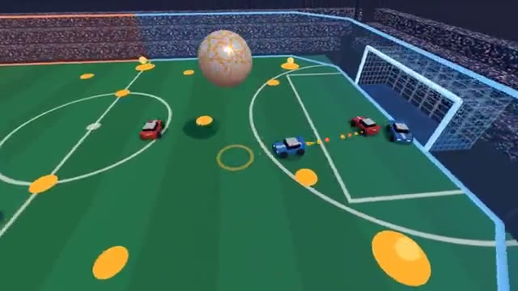

# Turbo Ball

Rocket cars, a giant ball, flip it in the net. A multiplayer starter game from [Multiplayer Agent](https://multiplayeragent.com): 3D, versus, 2–8 players, with bots that fill empty seats.

## How it plays

Drive into the ball to shove it toward the other team's goal. Jump to hit it in the air, jump again to flip into it hard, and grab glowing pads to refill your boost. Most goals after three minutes wins; a tie goes to overtime. Every goal blows up the ball and shows a slow-motion replay.

**Controls:** WASD or arrows to drive, Space to jump, Shift to boost, C for ball cam, or a thumb stick with Jump and Boost buttons.

## Make it yours in the Game Builder

Open the [Game Builder](https://multiplayeragent.com), choose **Start from a starter game** and pick Turbo Ball. It opens as version 1 in your studio, ready to play and publish. Then ask for changes, for example:

- Add a second ball after each goal
- Make the ball huge and slow, like a beach ball
- Add a speed pad that launches cars into the air

## Run it yourself

1. Get a free publishable key (`pk_…`) at [multiplayeragent.com](https://multiplayeragent.com).
2. In `index.html`, put it in place of `pk_REPLACE_ME` in the `MP_CONNECT` block.
3. Serve the folder (for example `npx serve`) and open it. The 3D engine loads as a module, which browsers block from a file on disk.

Without a key it still runs, offline against bots.

## How it is built

- One `index.html` plus three.js in `libs/`. The comment at the top of the script maps the code and explains the multiplayer.
- **Host-run physics:** One player's browser moves the ball and keeps the score, so everyone sees the same bounce; if it leaves, the next player takes over. Your own car's touches are decided on your screen, so a hit you see is a hit.
- **Leaderboard:** Most goals, for every player.
- **Bots:** Bots fill every empty seat, so it's always at least 3 against 3: one chases, one shadows, one guards the goal.
- **Live sync:** Every car and the ball move for everyone at once.
- `?attract` runs it offline, bots only, with a broadcast camera. The preview video is recorded from it.

## License

MIT.
